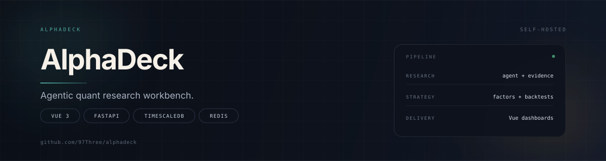
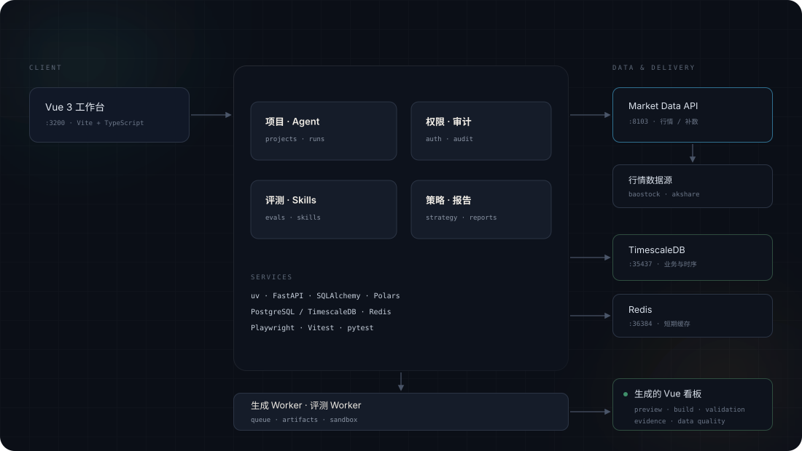

<p align="center">
  
</p>

<p align="center">
  <strong>从研究问题，到可交付的量化看板。</strong><br>
  用自然语言提出研究问题，Agent 取数、计算和生成，最终交付一个可预览、可验收的 Vue 看板。
</p>

---

## 能做什么

- **任务轨道式研究**：左侧切换研究任务，右侧选择模型与输出方式，实时跟踪 Agent 过程、证据、文件与生成结果。
- **行情与基本面**：股票 / ETF 宇宙、日线与实时快照、财务报告版本、补数与数据质量检查。
- **策略与回测**：因子目录、策略扫描、回测执行与结果留档。
- **看板生成**：每个项目生成独立的 Vue 看板，支持预览、构建与验收。
- **治理与运维**：权限、审计、评测、Skills 管理、运行治理与设置。
- **本地优先**：单机 Docker Compose，数据、模型 Key 与产物都留在本机。

## 架构

<p align="center">
  
</p>

- **Vue 工作台**（`:3200`）：页面、任务轨道与各功能入口，所有请求通过 `/api` 访问 Platform API。
- **Platform API**（`:38084`）：项目、Agent、权限、评测、Skills、策略与报告。
- **Market Data API**（`:8103`）：行情、补数、因子与回测数据。
- **Worker**：看板生成与评测任务，和 API 共用同一套数据与契约。
- **TimescaleDB**（`:35437`）与 **Redis**（`:36384`）：业务/时序数据与可丢失的短期缓存。

## 快速开始

建议在 **WSL2 / Linux** 下运行：看板生成与预览需要 Linux 隔离能力，Docker Desktop 需要开启对应发行版的集成。

前置：Node.js 22.19+、npm 10+、Python 3.14、[uv](https://docs.astral.sh/uv/)、Docker Compose。

```bash
npm run setup
npm run db:up
npm run db:init
npm run dev
```

打开 <http://127.0.0.1:3200>。

`npm run dev` 会同时启动 Vue、Platform API、Market Data API、生成 Worker 和评测 Worker；按 `Ctrl+C` 停止应用进程。数据库和 Redis 会保留在 Docker 中，需要停止时执行 `npm run db:down`。

模型 Key 只放在 `.env.local`，例如：

```bash
DEEPSEEK_API_KEY="..."
```

保存后重启 `npm run dev`，再到「设置」检查连接。**不要提交 `.env.local`。**

## 服务与端口

| 部分 | 地址 / 目录 | 用途 |
| --- | --- | --- |
| Vue 工作台 | `127.0.0.1:3200`，`web/` | 页面、任务轨道与各功能入口 |
| Platform API | `127.0.0.1:38084`，`services/platform-api/` | 项目、Agent、权限、评测、Skills、交付 |
| Market Data API | `127.0.0.1:8103`，`services/market-data/` | 行情、补数、策略与回测 |
| TimescaleDB | `127.0.0.1:35437` | 业务与时序数据 |
| Redis | `127.0.0.1:36384` | 可丢失的短期缓存 |
| 看板模板 | `config/vue-dashboard-template/` | 新项目的 Vue / Vite 模板 |

## 常用命令

```bash
npm run dev                  # 启动全部服务
npm run build                # 构建 Vue 工作台
npm run test:platform        # Platform API 单元与集成测试
npm run check:skills         # 校验内置 Skills 的源码、包哈希与脚本
npm run check:standalone-runtime
npm run check:integrations
npm run db:up / db:down      # 启停数据库与 Redis
npm run obs:up / obs:down    # 可选：Loki + Grafana + Alloy
```

## 目录结构

```text
web/                         Vue 3 + Vite + TypeScript 工作台
services/platform-api/       FastAPI 平台服务与 Agent
services/market-data/        FastAPI 行情服务
assets/                      项目横幅与架构图
config/                      看板模板与契约配置
prisma/                      Prisma schema 与迁移
sqls/                        TimescaleDB 初始化与增量 SQL
deploy/                      systemd 与部署配置
docs/                        架构、API、配置与运维文档
scripts/                     开发、构建与检查脚本
benchmarks/                  基准与评测数据
```

## 配置与安全

- 所有配置通过环境变量注入，示例见 `.env.example` 与 `.env.production.example`。
- `.env`、`.env.local`、`data/`、`tmp/`、`migration-reference/` 等均已在 `.gitignore` 中排除。
- 真实密钥只放 `.env.local` 或进程环境，不进入仓库。
- 工作台默认只监听本机地址，不要直接暴露到公网。
- 生产部署前请阅读 `docs/operations-runbook.md` 与 `docs/release-runbook.md`。

## 边界

这是本地、单用户的量化研究工作台，不是多租户 SaaS：不提供公网级身份体系、跨租户隔离或托管式运维。生成看板和评测任务依赖本机资源，长时间或大规模任务需要自行扩展 Worker。

## 许可证

[MIT](LICENSE)
